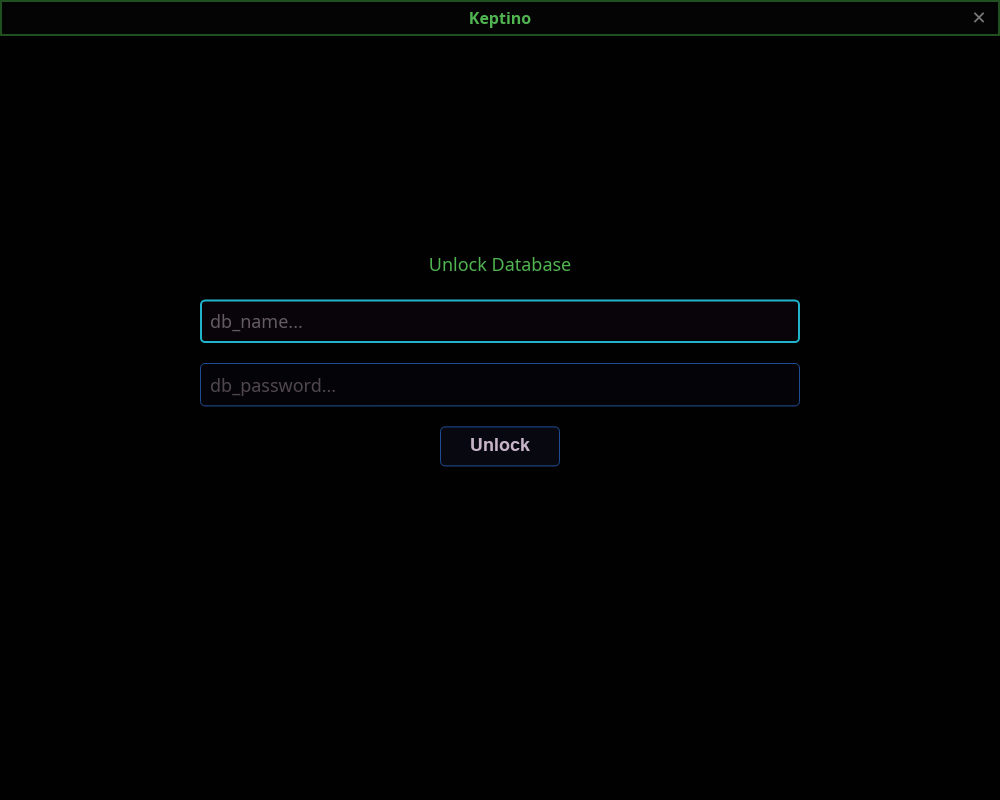
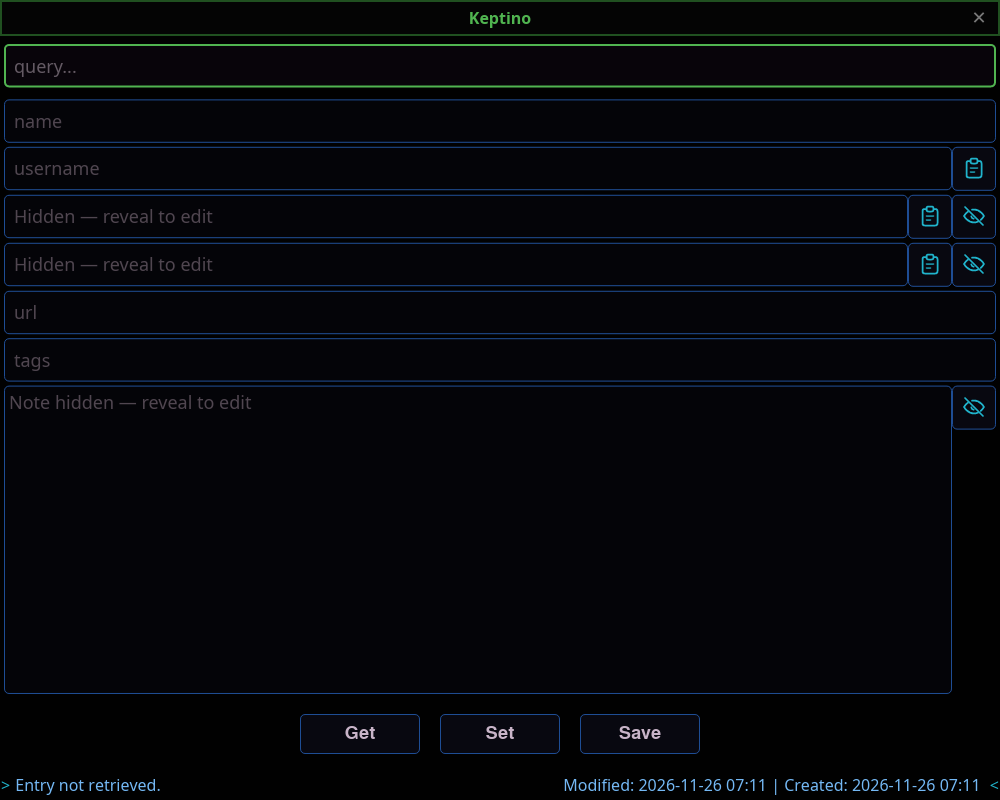
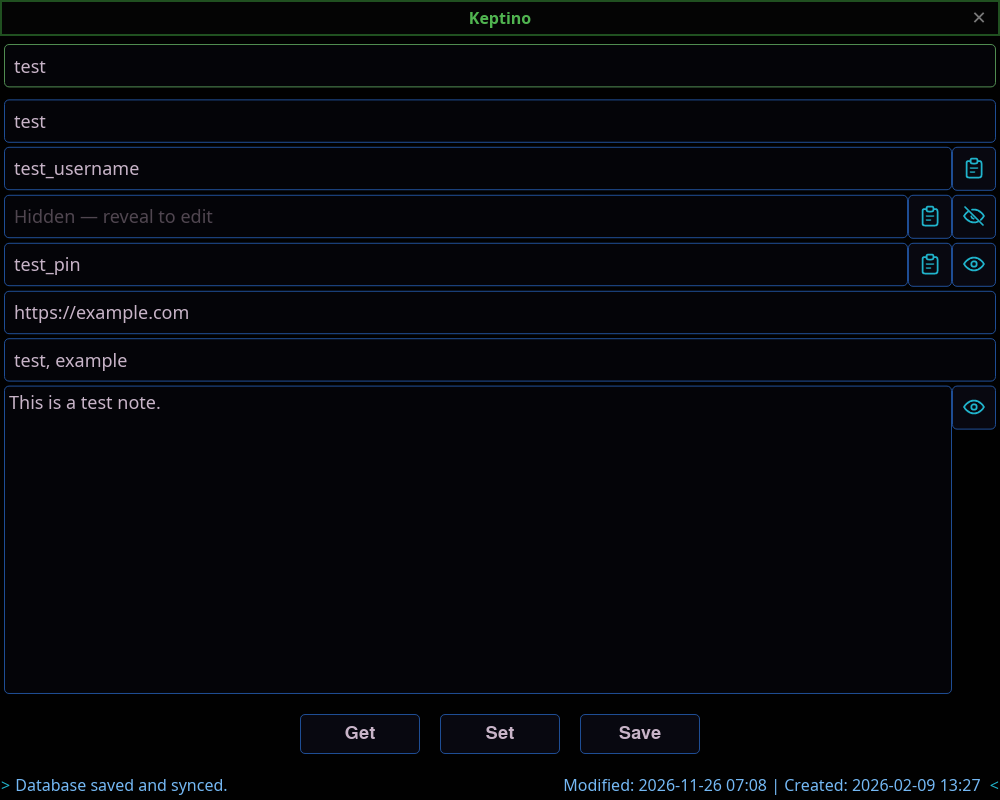

# Keptino

A password vault by nilket for Linux and Android.

Keptino was previously named DigiSafe. Existing installations use the same
`.digisafe` vault files, local credentials and cloud objects. On Linux, launch
it with `keptino`. The Debian package replaces `digisafe` and keeps the old
command and pinned desktop launcher working.

### Android

The Android app opens and edits Linux `.digisafe` vaults. See
[Android setup, builds, and interoperability tests](android/README.md). Existing
vaults require the original pepper and a device with enough available memory for
the Linux 4 GiB password derivation. The platform protections below describe Linux;
Android uses Android Keystore and the lifecycle protections documented separately.

### Linux features

 - 4GiB Argon2id / Sha3 salted and peppered master password derivation.
 - TPM locked pepper via systemd-creds.
 - Secret memory based master key storage.
 - Authenticated in-memory encryption of cached entries, passwords, PINs, and notes.
 - The entire app is unswappable and undumpable.
 - Dynamic linker hijacking blockage.
 - Tracing blockage. (ptrace, strace, ltrace, gdb)
 - Forensic-resistant clipboard clearing mechanism.
 - Linux vault sync on unlock and save with Backblaze B2, Amazon S3, Google Cloud Storage, or Cloudflare R2. API credentials use systemd-creds.
 - Atomic file io.
 - Reed-Solomon 8:4 erasure coding with BLAKE3 checksums and 4KiB+ shards.
 - XChaCha20Poly1305 encryption.
 - LZ4 level 9 compression.
 - Simple TLV serialization.
 - CPU rending only via tiny-skia.
 - Wayland only.

### Linux setup

On Debian/Ubuntu, install a Rust toolchain and run `./linux/setup.sh` as your
normal user. Setup uses sudo to install missing system dependencies
(`build-essential`, `pkg-config`, `dpkg-dev`, `argon2`, `systemd`, `libcap2-bin`,
`libwayland-dev`, and `libxkbcommon-dev`) and installs `cargo-deb` if needed.
It checks credential encryption and builds/installs Keptino before asking
for the pepper seed and credentials for your selected storage provider.

Package installation grants `/usr/bin/keptino` the `CAP_IPC_LOCK` capability
so it can lock its memory, including the 4 GiB password derivation, without
being constrained by the desktop session's memlock limit. This is reapplied
on upgrades. Launch the installed executable; a build in `target/` does not
have this capability.

Rerunning setup reuses the encrypted credentials in `~/.config/digisafe`.
Setup checks the pepper and the active provider credential. If either file
is empty or cannot be decrypted, setup stops for repair. Keep the original
pepper credential when using an existing vault.

To re-enter only the Backblaze credentials, run
`./linux/setup.sh --reset-backblaze`. This skips the build and preserves the
pepper. The old Backblaze file is replaced only after encryption succeeds.

To recover an invalid pepper credential, run `./linux/setup.sh --restore-pepper`
and enter the original pepper seed used for the vault. This skips rebuilding,
backs up the previous encrypted pepper, and validates the regenerated value
before replacing it. It preserves cloud storage credentials. A different seed
will not unlock an existing vault.

If setup reports `Unexpected TPM PCR state of the system`, the current boot
measurements do not satisfy the policy for the listed credential. With the
original pepper seed, use `--restore-pepper` at the local prompt. If the seed
is unavailable, keep the encrypted pepper and recover access in the boot
state in which it was sealed. Re-enter the storage key separately if setup
also lists the provider credential.

### Cloud storage on Linux

Keptino syncs one object named `<database name>.digisafe` in a private
bucket. All four providers store the same Base64-encoded encrypted vault.
Existing installations default to Backblaze B2 and reuse `backblaze.cred`.

| Provider | What to provision | Free storage terms |
| --- | --- | --- |
| Backblaze B2 (`backblaze`) | A read/write application key restricted to the vault bucket. Enter the key name, ID, and application key. | First 10 GB free. [B2 pricing](https://www.backblaze.com/cloud-storage/pricing) |
| Cloudflare R2 (`r2`) | A Standard bucket in the default jurisdiction. Create an Object Read & Write token scoped to that bucket. Enter the bucket name, account ID, access key ID, and secret access key. [R2 setup](https://developers.cloudflare.com/r2/get-started/s3/) | 10 GB-month each month with free operation allowances. [R2 pricing](https://developers.cloudflare.com/r2/pricing/) |
| Google Cloud Storage (`gcs`) | A Standard bucket and a service account with Storage Object User on that bucket. Create an HMAC key for the account. Enter the bucket name, location (e.g. `us-central1`), HMAC access ID, and secret. [HMAC keys](https://cloud.google.com/storage/docs/authentication/hmackeys) | 5 GB-month each month across `us-central1`, `us-east1`, and `us-west1`, subject to Free Tier limits. [Google Cloud pricing](https://cloud.google.com/storage/pricing) |
| Amazon S3 (`aws`) | A general purpose bucket and an IAM access key pair. Grant `s3:GetObject` and `s3:PutObject` on vault objects and `s3:ListBucket` on the bucket so a first unlock can distinguish a missing vault from denied access. Enter the bucket name, AWS region, access key ID, and secret access key. [S3 permissions](https://docs.aws.amazon.com/AmazonS3/latest/API/API_GetObject.html) | The new-customer free plan lasts up to six months. [S3 pricing](https://aws.amazon.com/s3/pricing/) |

To switch providers, first save your current vault and confirm the local
`~/.config/digisafe/<database name>.digisafe` file exists. Close Keptino
and run setup with the desired provider. For R2, run

```sh
./linux/setup.sh --configure-storage r2
```

This command provisions credentials and selects the provider without rebuilding
Keptino. Unlock the same database name and save once to upload it to an empty
destination bucket. Switching redirects future syncs and leaves the previous
bucket's object in place. To recover on another installation, configure the
same bucket and use the original pepper seed, database name, and master password.

Use one writer at a time. Unlock compares the local and remote modification
times. Each save uses a fresh nonce, including when editing a local copy offline.
If the provider is unreachable, an existing local copy opens with a
status message and saves locally for that session. Unlock again to check the
remote copy before uploading. A failed upload also leaves a local copy and
displays the error.

### Secrets in memory

Passwords, PINs, and notes stay encrypted while hidden, including in the selected
entry. Reveal a field to view or edit it; hide it when finished. Notes also start
hidden. Selecting another entry hides all secret fields again. Copying a password
or PIN does not require revealing it.

The memory layer uses XChaCha20-Poly1305 with random keys in `memfd_secret`, fresh
nonces, and authenticated field/record identifiers. Secret mappings are exclusive
and unmapped after use. Application-owned temporary plaintext buffers are wiped
on disposal; the master password is moved into the unlock task instead of cloned.
Existing vaults open and save in their original on-disk and Backblaze formats.

This reduces plaintext exposure while the application is idle. It does not
protect against an attacker controlling the process. Revealing/editing secrets,
copying them, and compressing a vault still involves Iced, clipboard, and LZ4
buffers whose internal copies are not guaranteed to be wiped. Clipboard history
and receiving applications can also retain copied secrets.

### Known Weaknesses

 - iced String buffers.
 - no virtual keyboard input.
 - bpftrace.
 - wayland-data-control.

#### Linux screenshots from the DigiSafe release






