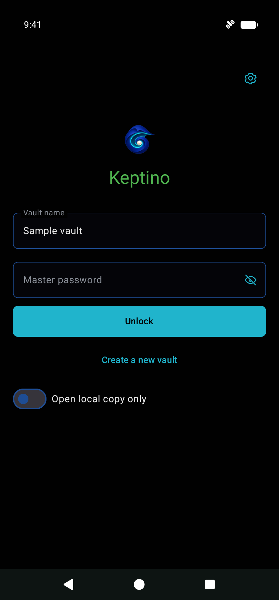
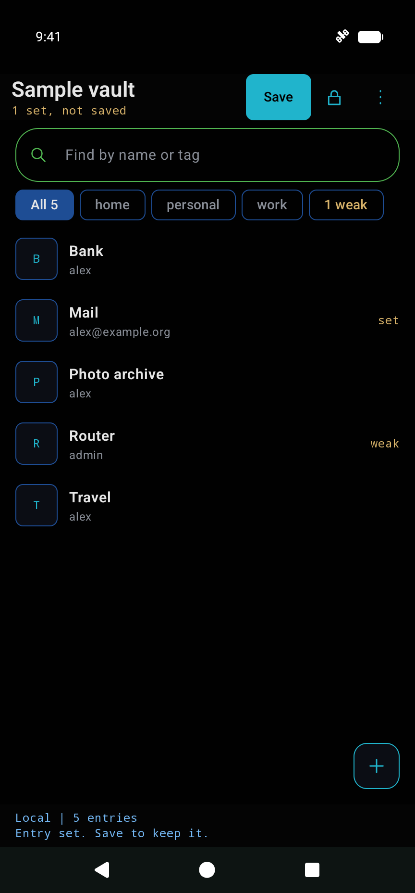
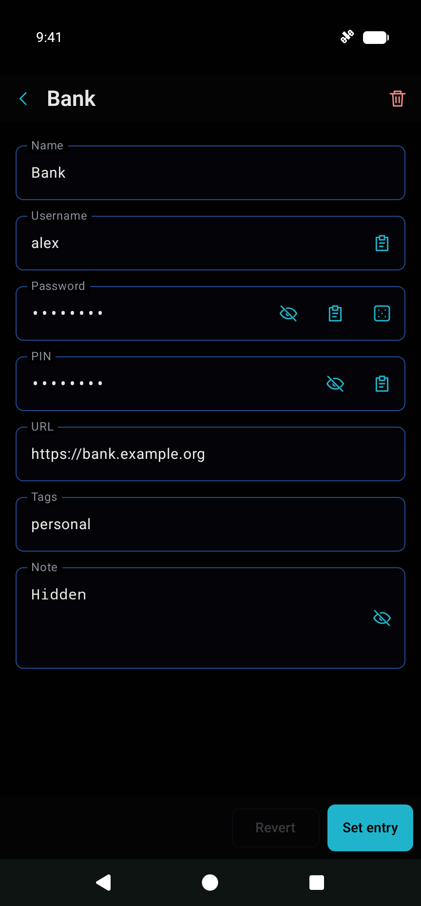
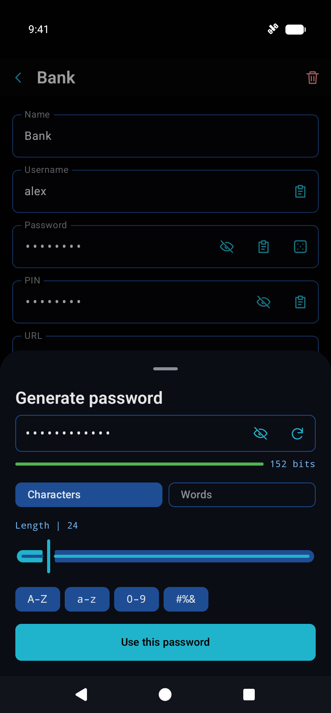

# Keptino

A password vault by nilket for Linux and Android. Both heads share one Rust
core (`libkeptino/`), one encrypted vault format, and the
[Nautilus design language](doc/design.md).

- **Offline-resistant vaults**: every vault combines the master password, a
  32-byte device-protected pepper, and optional FIDO2 `hmac-secret` security
  keys. Stealing a vault file from a disk or bucket is not enough to guess the
  master password offline.
- **Sealed in memory**: hidden passwords, PINs, and notes stay encrypted under
  per-record and per-field keys while the vault is unlocked on both Linux and
  Android.
- **Minimal attack surface**: no browser extension, auto-type, SSH agent,
  Secret Service interface, passkey store, or plugin system. Network traffic is
  limited to configured sync and provider authentication over one TLS client.

## Screenshots

### Linux


### Android screenshots

The four screens below use a sample vault. Select an image to view it at full size.

| Unlock | Vault list |
| --- | --- |
| [](doc/img/android/unlock.png) | [](doc/img/android/list.png) |

| Entry editor | Password generator |
| --- | --- |
| [](doc/img/android/entry.png) | [](doc/img/android/generator.png) |

## Cryptography and vault format

Both heads read and write the same `.keptino` format through `libkeptino`:

- **Key derivation**: Argon2id with SHA-3 pre- and post-hashing, a per-vault
  salt, a 32-byte pepper, and an optional 32-byte roaming secret from enrolled
  security keys.
  - **New vaults** created on Linux or Android derive and record **256 MiB,
    3 passes, 1 lane**.
  - **Existing vaults** keep their recorded cost on ordinary saves and rekeys.
    Legacy unmarked production vaults open at **4 GiB, 1 pass, 1 lane**.
  - **Pepper derivation** from the recovery seed uses **4 GiB, 4 passes,
    1 lane** (`keptino --derive-pepper` on Linux, native `libkeptino` on
    Android).
- **Encryption and framing**: XChaCha20-Poly1305 with a fresh nonce on
  every save, LZ4 framing in stored blocks with an in-tree reader that also
  opens older compressed vaults, and TLV serialization under shared
  input budgets (64 MiB file, 30 MiB decompressed vault, 100,000 records,
  16 MiB field).
- **Corruption repair**: Reed-Solomon 8+4 erasure coding with per-shard BLAKE3
  checksums, implemented in-tree (`libkeptino/src/erasure.rs`, no
  dependencies).
- **Mirror check and rollback floor**: every vault file carries its envelope
  metadata both outside and inside the ciphertext; opening fails unless both
  copies match exactly. Each save advances a monotonic `revision` checked
  against the highest revision already opened on the device.

## Platform protections

### Linux

- **Memory isolation**: whole-process `mlockall`, master and record keys in
  `memfd_secret` (outside the kernel direct map, unmapped between uses), and
  per-record / per-field XChaCha20-Poly1305 sealing in RAM.
- **Process hardening**: `PR_SET_DUMPABLE` disabled, `CAP_IPC_LOCK` on
  `/usr/bin/keptino` (enabling loader secure-execution mode against
  `LD_PRELOAD` and `LD_AUDIT`), refusal to start without memory locking,
  Wayland-only build, and CPU rendering via `tiny-skia`.
- **Sandboxing**: Landlock filesystem sandbox restricting Keptino and its
  helpers to system files, devices, the runtime directory, the font cache, and
  `~/.config/keptino`; hand-built cBPF seccomp deny filter (`TSYNC`,
  `no_new_privs`, killing foreign-arch/x32 calls and denying `ptrace`,
  `process_vm_*`, `bpf`, `io_uring`, `userfaultfd`, mounts, keyrings, and
  namespace creation). Kernels without Landlock or seccomp warn in the journal.
- **Secrets in memory**: passwords, PINs, and notes stay encrypted while hidden;
  copying does not require revealing a field. List views and find popovers use
  a non-secret list projection (`INDEX_LIST_ROWS`) and open no sealed records.
- **Locking and clipboard**: lock button and `Ctrl+L`, 4-minute idle lock,
  automatic lock on sleep or screensaver (`logind` and screensaver D-Bus
  signals), and a conditional, state-independent clipboard wipe that clears
  only what Keptino copied.
- **Vault hygiene and local recovery**: configurable password and EFF
  passphrase generator with whole-bit strength readout, offline password health
  report, two-press confirmed deletion, and atomic local saves keeping three
  previous generations (`<db>.keptino.1` to `.3`, mode `0600` in `0700`
  directory).

### Android

See [android/README.md](android/README.md) for full Android setup, builds,
signing, and interoperability tests. Highlights:

- **Keystore-wrapped settings**: pepper and sync credentials are encrypted by
  Android Keystore (StrongBox when present) and gated by device credential or
  strong biometric per use.
- **Sealed native memory**: shared `libkeptino` per-record and per-field
  sealing backed by best-effort `LockedPage`, with masked-by-default generator
  previews wiped on `ON_STOP` and dismissal.
- **Lifecycle and packaging**: `FLAG_SECURE`, backup and transfer excluded,
  cleartext traffic disabled, 2-minute idle lock, lock-on-screen-off enabled by
  default, conditional clipboard clearing, and release-signed, non-debuggable
  everyday installs targeting one explicit Android user profile.

## Security keys (FIDO2)

A FIDO2 security key with the `hmac-secret` extension (such as a YubiKey 5) can
protect a vault alongside the master password and pepper:

- Open the vault, choose **Keys**, and select **Protect with a security key**.
  The vault rekeys so every device then requires an enrolled key to unlock it.
- Up to four keys can be enrolled. Keep a backup key enrolled: a locked vault
  whose enrolled keys are all lost cannot be opened.
- Removing a key rekeys under a fresh roaming secret and asks for a touch from
  each remaining key.
- **Linux**: pure-Rust CTAP2 over USB HID (`/dev/hidrawN`); systemd udev rules
  grant access to the logged-in user.
- **Android**: USB-C host support on the Keys screen; NFC `IsoDep` is
  implemented and fixture-tested only.

## Cloud sync

Keptino syncs one Base64-encoded object named `<database name>.keptino` in a
private bucket. S3-compatible providers (`r2`, `gcs`, `aws`, and custom `s3`)
use Keptino's pure-Rust Signature Version 4 code over HTTPS (plaintext HTTP is
refused in release builds) with `If-Match` / `If-None-Match` preconditions so
writes refuse concurrent overwrites from another device. Backblaze B2
(`backblaze`) uses the B2 native API over HTTPS with a pre-upload check and
unconditional upload.

| Provider | What to provision | Free storage terms |
| --- | --- | --- |
| Cloudflare R2 (`r2`) | Standard bucket in the default jurisdiction and an Object Read & Write token scoped to that bucket. Enter bucket name, account ID, access key ID, and secret access key. [R2 setup](https://developers.cloudflare.com/r2/get-started/s3/) | 10 GB-month/month with free operation allowances. [R2 pricing](https://developers.cloudflare.com/r2/pricing/) |
| Backblaze B2 (`backblaze`) | Read/write application key restricted to the vault bucket. Enter key name, ID, and application key. | First 10 GB free. [B2 pricing](https://www.backblaze.com/cloud-storage/pricing) |
| Google Cloud Storage (`gcs`) | Standard bucket, service account with Storage Object User, and an HMAC key. Enter bucket name, location (e.g. `us-central1`), HMAC access ID, and secret. [HMAC keys](https://cloud.google.com/storage/docs/authentication/hmackeys) | 5 GB-month/month across `us-central1`, `us-east1`, and `us-west1`. [Google Cloud pricing](https://cloud.google.com/storage/pricing) |
| Amazon S3 (`aws`) | General-purpose bucket and an IAM key pair with `s3:GetObject`, `s3:PutObject`, and `s3:ListBucket`. Enter bucket name, AWS region, access key ID, and secret access key. [S3 permissions](https://docs.aws.amazon.com/AmazonS3/latest/API/API_GetObject.html) | New-customer free plan for up to six months. [S3 pricing](https://aws.amazon.com/s3/pricing/) |
| Custom S3 (`s3`) | Any S3-compatible store (such as RustFS or MinIO) with a trusted `https://` certificate. Enter endpoint URL, bucket, region (`us-east-1` default), and key pair. | Self-hosted |

### Create, unlock, and conflict rules

- **Unlock never creates**: a name absent both locally and in the bucket is
  reported, not created. Use **Create vault** on the locked screen to start a
  new vault. S3-compatible stores use a create-only (`If-None-Match`) upload.
  Backblaze B2 cannot refuse a concurrent create: on Linux do not create the
  same name on two devices at once, and on Android explicit Create requires
  Cloudflare R2 or local-only settings.
- **Revision and rollback checks**: Unlock compares local and remote candidates
  by `revision`, then modification time. A copy whose revision is below the
  highest already opened on the machine is refused (remove
  `~/.config/keptino/<db>.revision` to accept an older copy deliberately).
- **Offline and conflict handling**: if the provider is unreachable, an
  existing local copy opens and saves locally for that session. If another
  device uploaded in between, S3-compatible stores reject the conditional
  upload and Backblaze B2 stops at its pre-upload check; the save stays local
  and prompts you to unlock again first.

### Switching providers on Linux

Save your current vault, verify `~/.config/keptino/<db>.keptino` exists, close
Keptino, and run setup for the new provider (for example, Cloudflare R2):

```sh
./linux/setup.sh --configure-storage r2
```

Unlock the vault and save once to upload it to the new bucket. The previous
bucket's object stays untouched.

## Setup and reproducible builds

### Linux

On Debian or Ubuntu, install a Rust toolchain and run `./linux/setup.sh` as
your normal user. Setup installs missing build dependencies
(`build-essential`, `pkg-config`, `dpkg-dev`, `systemd`, `libcap2-bin`,
`libwayland-dev`, `libxkbcommon-dev`) and `cargo-deb` if needed, builds the
reproducible `.deb` via `./linux/build-deb.sh`, installs it with `CAP_IPC_LOCK`
on `/usr/bin/keptino`, and seals your pepper and provider credentials via
`systemd-creds`. Launch `/usr/bin/keptino` (builds in `target/` do not have
`CAP_IPC_LOCK`).

- **Re-enter Backblaze credentials**: `./linux/setup.sh --reset-backblaze`
- **Recover an invalid pepper credential**: `./linux/setup.sh --restore-pepper`
  and enter the original pepper seed (also recovers after an
  `Unexpected TPM PCR state of the system` error; if the seed is unavailable,
  keep the encrypted pepper and recover in the boot state in which it was
  sealed).
- **Reproducible release packages**: `./linux/build-deb.sh [--sign KEY] [OUTDIR]`
  pins `SOURCE_DATE_EPOCH`, remaps builder paths, and writes `BUILDINFO` and
  `SHA256SUMS` (with optional SSH signature `SHA256SUMS.sig`). Verify
  reproducibility with `./linux/repro-check.sh [COMMIT]`.

### Android

Back up your release signing key outside the checkout, connect your phone with
USB debugging authorized, and run:

```sh
./android/setup.sh
```

For the first upgrade from a debug installation, pass
`--rotate-from ~/.android/debug.keystore` with the original key once. Use
`--user ID` to target a specific Android user profile. See
[android/README.md](android/README.md) for key creation, rotation, and debug R2
provisioning (`--debug --r2`).

## Verification and security review

- **Security review and honest assessment**:
  [doc/security-review-vs-keepassxc-2026-11-26.md](doc/security-review-vs-keepassxc-2026-11-26.md)
  compares Keptino against KeePassXC on both design and assurance, with an
  explicit self-assessment caveat and up-to-date status through ADR 0034.
- **Supply-chain controls**: `Cargo.lock` pins dependencies under a seven-day
  cooldown (`.cargo/config.toml`, Cargo 1.100+). `cargo audit` checks
  advisories against accepted entries in `.cargo/audit.toml`.
- **Fuzzing**: `cargo test` runs deterministic mutation smoke tests over all
  nine `libkeptino` untrusted-input targets; run coverage-guided `libFuzzer` on
  stable Rust with `libkeptino/fuzz/run.sh TARGET [SECONDS]`.
- **Recovery drills**: `cargo test -p keptino drill` rehearses losing a daily
  FIDO2 key and recovering with a backup key; `./linux/recovery-drill.sh`
  rehearses five live RustFS and pepper-seed disaster cases on throwaway
  vaults.

## Deliberate exclusions and known limits

### Deliberate exclusions

Keptino omits browser integration, auto-type, SSH agent, Secret Service,
passkeys, plugins, breach-database lookups, and quick unlock that keeps a
derived key alive across locks. Each widens the IPC or network surface into the
process holding the master key. Copying through the clipboard is the only way a
secret leaves the process.

### Known limits

- **Revealed UI and clipboard buffers**: revealing, editing, or copying a
  secret involves `iced` / Compose and clipboard buffers whose internal
  copies are not guaranteed to be wiped. Clipboard history and
  receiving apps can retain copied secrets.
- **Host-level compromise**: an attacker controlling the running process or
  holding root on the host (for example, `bpftrace` uprobes or
  `wayland-data-control` observers) can read secrets as they are used.
- **Input**: no virtual keyboard input.
- **Assurance**: no independent third-party audit has reviewed Keptino yet.

## Upgrading from DigiSafe

Keptino was previously named DigiSafe.

- **Linux**: the Debian package replaces `digisafe` and keeps the `digisafe`
  command working (update any dock pin to `Keptino`). Run `./linux/setup.sh`
  before opening Keptino: if `~/.config/keptino` does not exist, setup moves
  `~/.config/digisafe` there, renames vaults to `.keptino`, and re-wraps the
  TPM-sealed pepper under its new credential name without writing plaintext to
  disk. If both directories exist, setup leaves `~/.config/digisafe` untouched.
- **Cloud objects**: Keptino reads and writes `<database name>.keptino`. If
  your latest vault is in the cloud as `<database name>.digisafe`, copy it to
  `<database name>.keptino` in your provider's console before unlocking, or
  unlock your migrated local copy and save once to upload under the new name.
